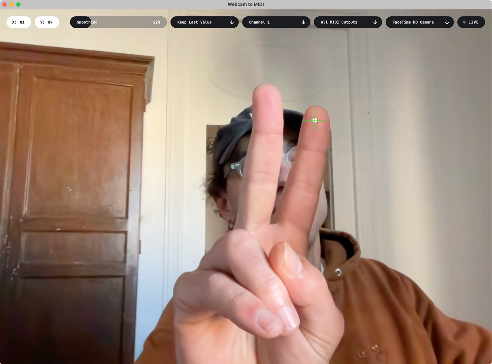

# Webcam to MIDI

Tracks your index fingertip with the webcam and sends its position as two MIDI CC values.



- **X → CC 20**, **Y → CC 21**, range **0–127** (left→right, bottom→top)
- **Green cross**: raw tracking position
- **White dot**: smoothed value. This is what gets sent.
- **Smoothing 0–100%**: 0% follows the finger instantly, 100% glides with about a 1 s time constant
- **Hand lost**: *Keep Last Value* holds the output, or *Set to 0 / 0* glides back to zero
- **Channel**: one of 1–16, or all channels at once
- **MIDI output**: the app's own **"Webcam MIDI"** port (macOS), *All MIDI Outputs*, or any single port
- **Camera**: any connected camera
- **X / Y pills**: click one to stop sending that CC. It dims to 30%; click again to resume.
- **LIVE**: toggle. Floats the window above other apps and on every desktop/Space, and hides the controls.
- **Runs in the background**: App Nap and WebKit/WebView2 background throttling are disabled, so tracking continues behind your DAW.

## Privacy: no network access

Everything runs locally and the app makes no network requests. MediaPipe's web runtime normally POSTs usage metrics to `odml.pa.googleapis.com` every 60 s. That is blocked by a Content Security Policy (`src-tauri/tauri.conf.json`) and a fetch/XHR guard (`src/netguard.js`). Any blocked attempt is printed to stderr as `[network blocked] <url>`. The only download is the hand model, fetched once at **build** time.

Built with [Tauri 2](https://tauri.app): the system webview for the UI, MediaPipe Hand Landmarker (runs locally, offline), and a small Rust core using [`midir`](https://github.com/Boddlnagg/midir) for MIDI. The installer is about 12 MB.

## MIDI routing

| | Own virtual port | Other options |
|---|---|---|
| macOS | ✅ **"Webcam MIDI"** shows up in any DAW as a MIDI input | IAC Driver bus, hardware ports |
| Windows | ❌ Windows (WinMM) doesn't let apps publish ports | Install [loopMIDI](https://www.tobias-erichsen.de/software/loopmidi.html), create a port, select it here |

## Develop

Requirements: Node 22+, Rust (stable), and on Windows the WebView2 runtime (preinstalled on Windows 10/11).

```sh
npm install
npm run dev      # run with hot reload of the web UI
npm run build    # build an installer for the current OS
```

`npm run prepare-assets` runs automatically. It copies the MediaPipe WASM and fonts into `src/vendor/` and downloads the hand model once. All of it is git-ignored.

Build output:

- macOS: `src-tauri/target/release/bundle/dmg/*.dmg` and `…/macos/Webcam to MIDI.app`
- Windows: `src-tauri/target/release/bundle/nsis/*-setup.exe`

Each OS has to be built on that OS. To get both, push a `v*` tag and GitHub Actions builds a universal macOS `.dmg` and a Windows setup `.exe`, then attaches them to the GitHub release for that tag. Running the **Build** workflow manually uploads them as workflow artifacts instead.

## Unsigned builds

The apps aren't code-signed.

- **macOS**: on first launch, right-click the app → *Open* (or run `xattr -cr "/Applications/Webcam to MIDI.app"`), then allow camera access.
- **Windows**: SmartScreen → *More info* → *Run anyway*.
